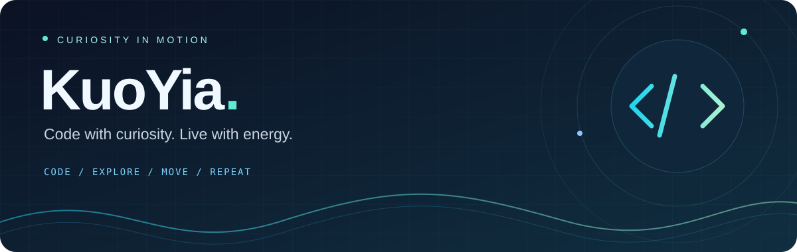

  

# 👋 你好，我是阔易安 · KuoYia

**💻 用代码实现想法，用运动积蓄能量。**

热爱编程，也热爱球场、泳池、跑道和健身房。  
在技术里保持好奇，在生活里保持热爱。✨

<a href="https://github.com/KuoYia?tab=repositories"><b>📦 探索我的仓库</b></a>
&nbsp; · &nbsp;
<a href="#-代码之外也要热爱生活"><b>🏸 我的运动生活</b></a>
&nbsp; · &nbsp;
<a href="#-正在探索的世界"><b>🧭 技术探索</b></a>

 

## ⚡ 关于我

> **认真写代码，痛快去运动。每一次尝试，都让自己向前一点。**

我是 **阔易安**，一个热爱编程、喜欢动手探索的人。🚀  
我喜欢把「这个想法能不能实现？」变成可以运行的代码，也享受从读懂原理到做出作品的过程。

🔍 **保持好奇** — 关注数据隐藏、图像安全、水声通信与 AI 工具。  
🛠️ **动手创造** — 喜欢算法复现，也喜欢有细节、有美感的交互式网页。  
📝 **认真记录** — 用中文说明整理思路，让实现方法和实验过程更容易理解。  
🌱 **持续成长** — 在实践中学习，在反馈中改进。

 

## 🧭 正在探索的世界

| 方向 | 我感兴趣的事 |
| :--- | :--- |
| 🔐 **数据隐藏 · 图像安全** | 可逆数据隐藏、加密图像中的信息嵌入与恢复 |
| 🌊 **水声通信 · 信道适应** | 复杂信道下的信息传输，以及与数据隐藏结合的可能性 |
| 🎨 **网页交互 · 可视化** | 丰富的动态交互、细腻的视觉表达、中华传统文化主题网页 |
| 🤖 **AI · 编程实践** | 用 AI 辅助阅读、编程与资料整理，把灵感逐步变成作品 |

 

## 🏸 代码之外，也要热爱生活

### 🏸 羽毛球 &nbsp; 🏊 游泳 &nbsp; 🏃 跑步 &nbsp; 🏋️ 健身 &nbsp; 💻 编程

**动起来，也静下心。热爱不止一种，生活不止一面。**

| 我的热爱 | 属于我的快乐 |
| :--- | :--- |
| 🏸 **热爱打羽毛球** | 享受挥拍、奔跑和来回对抗的节奏 |
| 🏊 **热爱游泳** | 在水里舒展身体，让思绪慢下来 |
| 🏃 **热爱跑步** | 跟着自己的节奏，一步一步向前 |
| 🏋️ **热爱健身** | 感受坚持带来的变化，积累力量与状态 |
| 💻 **热爱编程** | 把脑海里的想法，写成真正能运行的东西 |

 

## 🛠️ 从想法到作品

**💡 提出问题 → 📖 理解原理 → ⌨️ 动手实现 → 🧪 实验验证 → ✨ 持续打磨**

我希望这里的每个项目，都能说清楚三个问题：

- **做了什么？** 介绍目标、功能与适用场景。
- **怎样运行？** 写清环境、步骤与使用方法。
- **有哪些边界？** 如实记录实验结果、局限和待完善的部分。

<b>📓 展开看看我的项目习惯</b>

 

🔬 区分原始资料的结论与自己的分析推断。  
🧩 先理解，再实现；先验证，再下结论。  
📚 为代码留下清楚的中文说明和复现步骤。  
🎯 关注真实问题，也认真打磨交互体验。  
🌱 接受项目不完美，持续把它做得更好。

 

---

### 🌟 保持好奇，保持热爱，保持向前。

**🏸 打好下一球 · 🏊 游好下一程 · 🏃 跑好下一步 · 🏋️ 练好下一组 · 💻 写好下一行**

欢迎交流技术、分享想法，也欢迎聊聊运动。🙌

Made with curiosity, code &amp; a love for life. 💙

